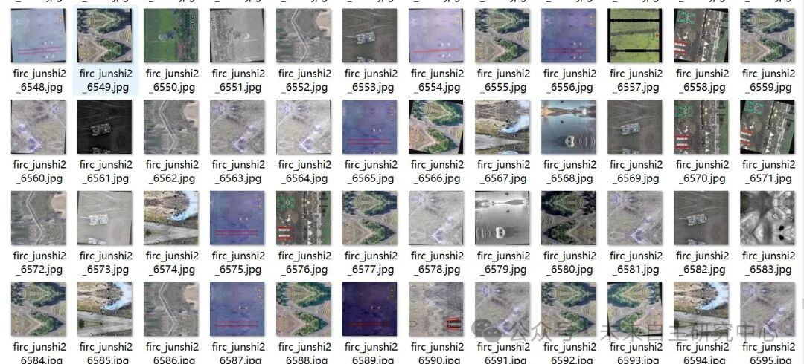
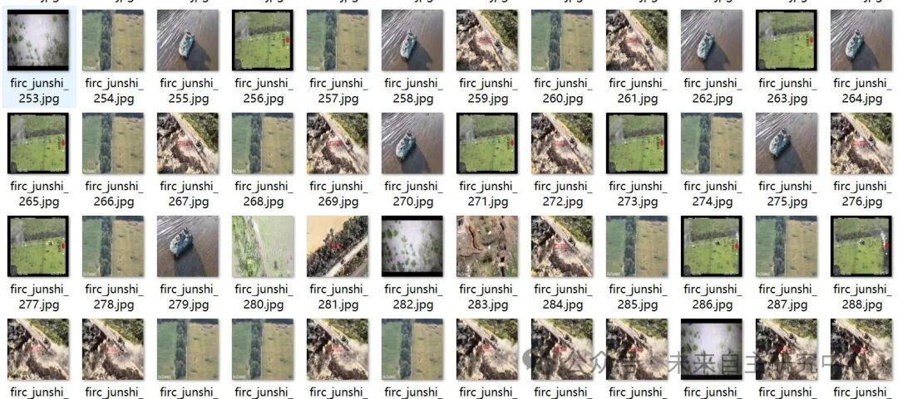
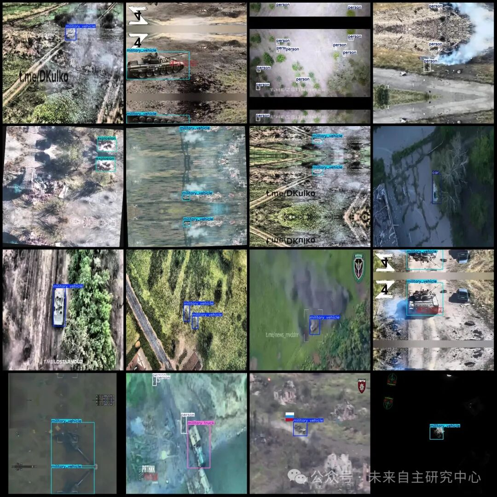

# UAV-Viewpoint Military Target Detection Dataset VOC+YOLO format with 14,126 images in 9 categories

The dataset includes some enhancements, with resolutions of 640x640 (approximately 5000+ images) and 1280x1280 (approximately 8000+ images), exceeding 2GB in size.

Dataset format: Pascal VOC format + YOLO format (txt file without split path, only containing jpg images and corresponding VOC format xml files and yolo format txt files)

Number of images (number of jpg files): 14126

Number of annotations (number of xml files): 14126

Number of annotations (number of txt files): 14126

Label category count: 9

Label category names (note that the order of categories in the YOLO format does not correspond to this, but is based on the labels folder's classes.txt): ["artillery", "car", "explosion", "military truck", "military vehicle", "military_vehicle", "person", "tank", "truck"]

Number of boxes labeled in each category:

Artillery frame count = 190

Car frame count = 344

Explosion frame count = 1398

Military truck frame count = 431

Military vehicle frame count = 6787

military_vehicle Frame Count = 22733

Person Frames = 11327

tank frame count = 2698

Truck frame count = 1572

Total frame count: 47480

Using labelImg:

Annotation rules: Draw a rectangle around the category.

Important Notice: No

Special : This dataset does not guarantee the accuracy or precision of the trained models or weight files. The dataset is provided with accurate and reasonable annotations only.

Image Preview:

Annotation example:

## Payment

Here is a pay link on Stripe ( https://buy.stripe.com/3cs8yP7sY87d0vu9AB ). Please contact me lonlonago@foxmail.com after funding $89, and I will send you a complete data files , thank you!

